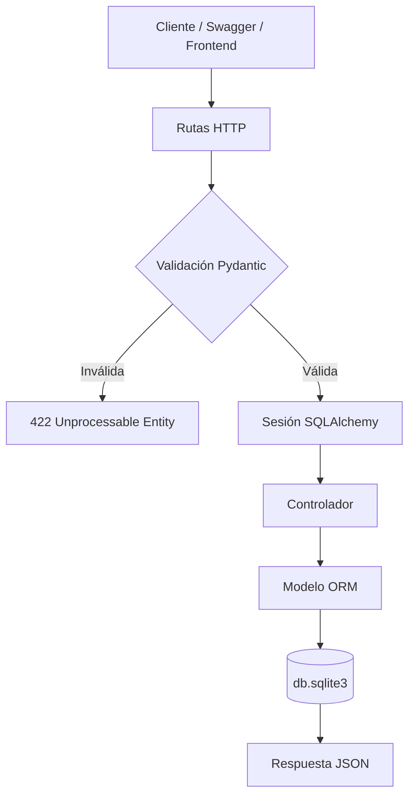
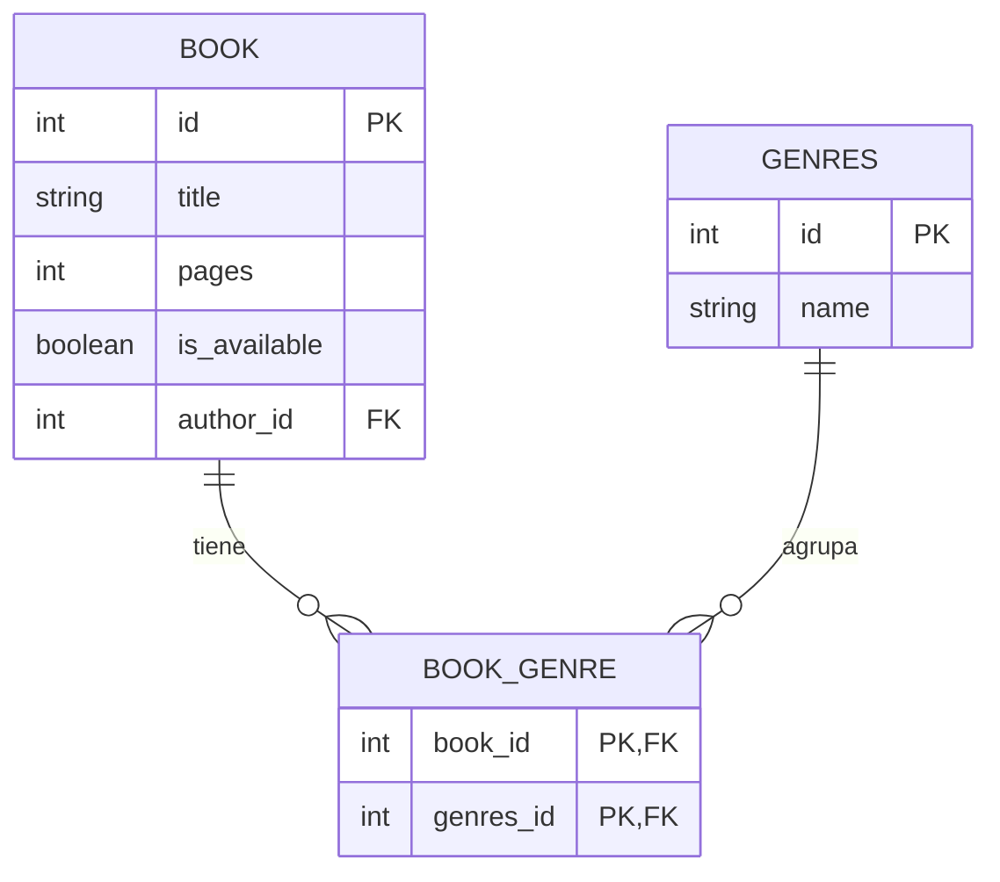

# API de Gestión de Libros con FastAPI y SQLite

Este repositorio contiene una API REST didáctica para gestionar libros y autores utilizando **FastAPI**, **SQLAlchemy**, **SQLite** y **Alembic**. El proyecto está organizado por capas para separar la configuración, la conexión a la base de datos, los modelos ORM, los esquemas Pydantic, los controladores y las rutas HTTP.

> **Nota:** El código fuente está escrito en inglés y esta guía está redactada en español para explicar el proyecto paso a paso. La API está preparada para ser consumida por Swagger, Postman o un frontend independiente.

## Índice

1. [Arquitectura y estructura](#arquitectura-y-estructura)
2. [Requisitos previos](#requisitos-previos)
3. [Instalación paso a paso](#instalación-paso-a-paso)
4. [Migraciones con Alembic](#migraciones-con-alembic)
5. [Tablas y relación Many-to-Many (Libros y Géneros)](#tablas-y-relación-many-to-many-libros-y-géneros)
6. [Arrancar el servidor](#arrancar-el-servidor)
7. [Pruebas con Swagger UI](#pruebas-con-swagger-ui)
8. [Endpoints y ejemplos](#endpoints-y-ejemplos)
9. [Estado actual](#estado-actual)
10. [Resolución de problemas](#resolución-de-problemas)

## Arquitectura y estructura

La estructura actual del proyecto es la siguiente:

```text
fastapi-api/
|
├── main.py                         # Punto de entrada de FastAPI
├── alembic.ini                     # Configuración de Alembic
├── alembic/
│   ├── env.py                      # Conexión de Alembic con SQLAlchemy
│   ├── README
│   ├── script.py.mako              # Plantilla de migraciones
│   └── versions/                   # Historial de cambios de la base de datos
├── config/
│   ├── __init__.py
│   └── config_variables.py         # Variables de entorno
├── database/
│   ├── __init__.py
│   └── database.py                 # Motor, Base y sesiones SQLAlchemy
├── model/
│   ├── __init__.py
│   ├── author_model.py             # Modelo ORM de authors
│   ├── book_model.py               # Modelo ORM de book
│   └── genre_model.py              # Modelo ORM de genres y tabla book_genre
├── schema/
│   ├── __init__.py
│   ├── author_schema.py            # Esquemas Pydantic de autores
│   ├── book_schema.py              # Esquemas Pydantic de libros
│   └── genre_schema.py             # Esquemas Pydantic de géneros
├── controller/
│   ├── __init__.py
│   ├── author_controller.py        # Operaciones de autores
│   ├── book_controller.py          # Operaciones de libros
│   └── genre_controller.py         # Operaciones de géneros
├── routes/
│   ├── __init__.py
│   ├── author_routes.py            # Rutas /author/
│   ├── genre_routes.py             # Rutas /genre/
│   └── routes.py                   # Rutas /book/
├── .env                            # Configuración local
├── .env.example                    # Plantilla de configuración
├── db.sqlite3                      # Base de datos SQLite local
├── requirements.txt                # Dependencias
└── README.md                       # Esta documentación
```

### Flujo de una petición

1. El cliente envía una petición HTTP a una ruta de `routes/`.
2. FastAPI valida el cuerpo mediante los esquemas de `schema/`.
3. `Depends(get_db)` proporciona una sesión SQLAlchemy.
4. La ruta delega la operación al controlador correspondiente.
5. El controlador consulta o modifica los modelos ORM de `model/`.
6. SQLAlchemy guarda o recupera los datos de SQLite.
7. Pydantic serializa el objeto ORM y FastAPI devuelve la respuesta JSON.



## Requisitos previos

Antes de comenzar necesitas:

- Python 3.10 o superior.
- `pip`.
- Un editor de código, como VS Code.

Puedes comprobar las versiones con:

```bash
python3 --version
pip --version
```

## Instalación paso a paso

### Paso 1: Situarse en el proyecto

```bash
cd /ruta/hacia/fastapi-api
```

### Paso 2: Crear el entorno virtual

En macOS y Linux:

```bash
python3 -m venv venv
```

En Windows:

```powershell
python -m venv venv
```

### Paso 3: Activar el entorno virtual

macOS o Linux:

```bash
source venv/bin/activate
```

Windows PowerShell:

```powershell
.\venv\Scripts\Activate.ps1
```

Windows CMD:

```cmd
.\venv\Scripts\activate.bat
```

### Paso 4: Instalar las dependencias

Con el entorno virtual activado:

```bash
pip install -r requirements.txt
```

Las dependencias principales son:

- `fastapi`: framework para construir la API.
- `uvicorn`: servidor ASGI.
- `sqlalchemy`: ORM para trabajar con SQLite.
- `alembic`: migraciones de la base de datos.
- `pydantic`: validación y serialización de datos.
- `python-dotenv`: lectura del archivo `.env`.

### Paso 5: Configurar las variables de entorno

El archivo `.env` utiliza esta configuración:

```env
APP_TITLE="Library"
APP_VERSION="0.0.1"
APP_DESCRIPTION="app de una librería"
DATABASE_NAME="db.sqlite3"
DATABASE_URL="sqlite:///./db.sqlite3"
```

Si el archivo `.env` no existe, puedes copiar la plantilla:

```bash
cp .env.example .env
```

`config/config_variables.py` aplica valores por defecto cuando una variable no está definida.

## Migraciones con Alembic

### ¿Por qué usamos Alembic?

`Base.metadata.create_all()` solo crea una tabla cuando todavía no existe. No modifica una tabla existente si añadimos una columna, cambiamos una restricción o incorporamos una relación.

Por ejemplo, cuando el modelo `Book` pasó de tener un autor como texto a utilizar `author_id`, `create_all()` no podía actualizar la tabla antigua. Alembic permite describir ese cambio en una migración y aplicarlo sin borrar los datos.

Alembic registra la revisión aplicada en la tabla `alembic_version`.

### Configuración de Alembic en este proyecto

El archivo `alembic/env.py` realiza estas tareas:

1. Añade la raíz del proyecto a `sys.path`.
2. Carga `DATABASE_URL` desde `.env`.
3. Importa `model` para que `Base.metadata` conozca `Book` y `Author`.
4. Configura las migraciones en modo offline u online.
5. Ejecuta `context.run_migrations()`.

La URL actual es:

```env
DATABASE_URL="sqlite:///./db.sqlite3"
```

### Historial de migraciones

Las revisiones del proyecto forman esta evolución:

1. `6d27021d7129`: crea la tabla `book` con título, páginas y disponibilidad.
2. `0a83a52985a0`: crea `authors` y añade `author_id` a `book`.
3. `c2a4ca782d46`: continúa la evolución de autores y libros.
4. `a8ff7600e682`: corrige la relación entre ambas tablas.
5. `9ba96e651b3f`: revisión de corrección del modelo de libros.
6. `cf0f74d0ff4e`: revisión de corrección de los modelos.
7. `d4f2c8a9b1e0`: permite que `book.pages` sea `NULL`.
8. `fd36481dd164`: crea la tabla `genres` y la tabla intermedia `book_genre` (relación N:M).
9. `92d5f0776a95`: ajuste en la relación de libros dentro de géneros.
10. `a2dcb78be1bc`: sincronización final de la relación bidireccional.

La revisión actual es `a2dcb78be1bc`.

La migración `d4f2c8a9b1e0` utilizó `batch_alter_table`, porque SQLite tiene limitaciones para modificar columnas mediante `ALTER TABLE` convencional. La migración `fd36481dd164` incorporó la tabla de géneros e intermedia con claves foráneas en cascada.

### Aplicar las migraciones

Desde la raíz del proyecto y con el entorno virtual activado:

```bash
alembic upgrade head
```

Para consultar el estado:

```bash
alembic current
alembic heads
alembic history --verbose
```

La salida esperada de `alembic current` termina en:

```text
a2dcb78be1bc (head)
```

### Crear una nueva migración

Cuando se modifica un modelo SQLAlchemy:

```bash
alembic revision --autogenerate -m "describe el cambio"
```

Antes de aplicarla, revisa siempre el archivo creado en `alembic/versions/`. Después ejecuta:

```bash
alembic upgrade head
```

Para deshacer la última revisión:

```bash
alembic downgrade -1
```

Para volver al estado inicial:

```bash
alembic downgrade base
```

## Tablas y relación Many-to-Many (Libros y Géneros)

En esta rama (`relation-many-to-many`) se implementa la relación de **muchos a muchos (N:M)** entre **libros** (`book`) y **géneros literarios** (`genres`):

- Un libro puede pertenecer a varios géneros (por ejemplo: Novela de aventuras, Ficción, Clásico).
- Un género literario puede agrupar múltiples libros.
- La asociación se materializa mediante la tabla asociativa intermedia **`book_genre`**.



### Paso 1: Crear la tabla intermedia y el modelo `Genre`

Para modelar la relación N:M en SQLAlchemy, se crea el archivo `model/genre_model.py` definiendo la tabla asociativa `book_genres` mediante un objeto `Table` y el modelo declarativo `Genre`:

```python
from sqlalchemy import Column, Integer, String, ForeignKey, Table
from sqlalchemy.orm import relationship
from database.database import Base

# Tabla asociativa intermedia
book_genres = Table(
    "book_genre",
    Base.metadata,
    Column("book_id", Integer, ForeignKey("book.id", ondelete="CASCADE"), primary_key=True),
    Column("genres_id", Integer, ForeignKey("genres.id", ondelete="CASCADE"), primary_key=True),
)

class Genre(Base):
    __tablename__ = "genres"

    id = Column(Integer, primary_key=True, index=True, autoincrement=True)
    name = Column(String(100), nullable=False, index=True)

    # Relación muchos a muchos con Book a través de la tabla asociativa
    books = relationship("Book", secondary=book_genres, back_populates="genres")
```

Detalles de la implementación:
- `book_genres` se define mediante `Table(...)` sin requerir una clase ORM propia, ya que únicamente guarda las claves foráneas de asociación.
- **Clave primaria compuesta:** `book_id` y `genres_id` actúan conjuntamente como clave primaria (`primary_key=True`), impidiendo registrar la misma relación por duplicado.
- **Eliminación en cascada:** `ondelete="CASCADE"` asegura que si se elimina un libro o un género, sus filas asociadas en `book_genre` se eliminen automáticamente.

### Paso 2: Configurar la relación Many-to-Many en `Book` con `secondary`

En `model/book_model.py` se importa la tabla intermedia y se conecta la relación inversa hacia `Genre`:

```python
from model.genre_model import book_genres

class Book(Base):
    __tablename__ = "book"
    # ... columnas id, title, pages, is_available, author_id ...

    author = relationship("Author", back_populates="books")
    genres = relationship("Genre", secondary=book_genres, back_populates="books")
```

El parámetro `secondary=book_genres` instruye a SQLAlchemy a resolver la navegación bidireccional (`book.genres` y `genre.books`) a través de la tabla asociativa de forma automática.

### Paso 3: Generar y aplicar las migraciones con Alembic

Con los modelos actualizados, se genera la migración para crear `genres` y `book_genre`:

```bash
alembic revision --autogenerate -m "add genres and book_genres many to many table"
```

Esto generó la revisión `fd36481dd164`, que ejecuta en SQLite:

```python
def upgrade() -> None:
    op.create_table('genres',
        sa.Column('id', sa.Integer(), autoincrement=True, nullable=False),
        sa.Column('name', sa.String(length=100), nullable=False),
        sa.PrimaryKeyConstraint('id')
    )
    op.create_index(op.f('ix_genres_id'), 'genres', ['id'], unique=False)
    op.create_index(op.f('ix_genres_name'), 'genres', ['name'], unique=False)
    op.create_table('book_genre',
        sa.Column('book_id', sa.Integer(), nullable=False),
        sa.Column('genres_id', sa.Integer(), nullable=False),
        sa.ForeignKeyConstraint(['book_id'], ['book.id'], ondelete='CASCADE'),
        sa.ForeignKeyConstraint(['genres_id'], ['genres.id'], ondelete='CASCADE'),
        sa.PrimaryKeyConstraint('book_id', 'genres_id')
    )
```

Para aplicar los cambios en la base de datos:

```bash
alembic upgrade head
```

### Paso 4: Definir los esquemas Pydantic y resolver dependencias circulares

Se crean los esquemas para géneros en `schema/genre_schema.py`:

```python
from typing import List, Optional
from pydantic import BaseModel, ConfigDict, Field

class GenreBase(BaseModel):
    name: str = Field(..., min_length=1, max_length=100, examples=["Novela de aventuras"])

class GenreCreate(GenreBase):
    pass

class GenreUpdate(BaseModel):
    name: Optional[str] = Field(None, min_length=1, max_length=100)

class GenreResponse(GenreBase):
    id: int = Field(..., description="Primary Key")
    model_config = ConfigDict(from_attributes=True)

# Importación diferida para resolver la dependencia circular
from schema.book_schema import BookSimpleResponse

class GenreDetailResponse(GenreResponse):
    books: List[BookSimpleResponse] = Field(default=[], description="List")
```

En `schema/book_schema.py` se actualizan los esquemas para admitir géneros y evitar ciclos infinitos en JSON:

```python
# Esquema de creación: recibe una lista opcional de IDs de géneros
class BookCreate(BookBase):
    genre_ids: Optional[List[int]] = Field(
        default=[],
        description="List id of genres",
        examples=[[1, 2]]
    )

# Esquema simple sin relaciones anidadas (usado dentro de GenreDetailResponse)
class BookSimpleResponse(BookBase):
    id: int = Field(..., description="PK database", examples=[1])
    model_config = ConfigDict(from_attributes=True)

# Importación diferida para resolver la dependencia circular
from schema.genre_schema import GenreResponse

# Esquema completo con autor y géneros anidados
class BookResponse(BookSimpleResponse):
    author: Optional[AuthorResponse] = None
    genres: List[GenreResponse] = []
    model_config = ConfigDict(from_attributes=True)
```

> [!IMPORTANT]
> **Resolución de la dependencia circular (Circular Import):**
> `BookResponse` necesita el esquema `GenreResponse`, mientras que `GenreDetailResponse` necesita el esquema `BookSimpleResponse`.
> Si ambos módulos importaran en la cabecera del archivo, Python fallaría con:
> `ImportError: cannot import name 'BookSimpleResponse' from partially initialized module 'schema.book_schema'`.
> Para resolverlo:
> 1. En `genre_schema.py`, `GenreResponse` se declara **antes** de importar `BookSimpleResponse`.
> 2. En `book_schema.py`, `BookSimpleResponse` se declara **antes** de importar `GenreResponse`.
> 3. En `schema/__init__.py` se exportan todos los esquemas (`BookSimpleResponse`, `GenreResponse`, `GenreDetailResponse`, etc.) de forma coordinada.
> De este modo, ambos módulos pueden cargarse sin dependencias circulares y sin bucles infinitos en la serialización JSON.

### Paso 5: Implementar los controladores para la relación N:M

En `controller/genre_controller.py`:
- `get_all()`: utiliza `.options(joinedload(Genre.books))` para que SQLAlchemy realice una consulta `JOIN` y cargue los libros relacionados de una sola vez, optimizando el rendimiento (evitando consultas N+1).
- `create_genre()`: comprueba si el nombre ya existe para evitar duplicados antes de insertar.

```python
def get_all(db: Session, skip: int = 0, limit: int = 100) -> List[Genre]:
    return (
        db.query(Genre)
        .options(joinedload(Genre.books))
        .offset(skip)
        .limit(limit)
        .all()
    )
```

En `controller/book_controller.py`:
- `create_book()`: al recibir `genre_ids`, consulta los géneros existentes en la base de datos y los vincula directamente a `new_book.genres`:

```python
if book_data.genre_ids:
    genres = db.query(Genre).filter(Genre.id.in_(book_data.genre_ids)).all()
    new_book.genres = genres
```

SQLAlchemy se encarga automáticamente de insertar los registros correspondientes en la tabla intermedia `book_genre`.

### Paso 6: Crear las rutas HTTP de géneros y registrarlas en `main.py`

En `routes/genre_routes.py` se exponen los endpoints correspondientes:

```python
router = APIRouter(prefix="/genre", tags=["Genre"])

@router.get("/", response_model=List[GenreDetailResponse], summary="Read a genres")
def read_genre(skip: int = Query(0, ge=0), limit: int = Query(100, ge=1, le=100), db: Session = Depends(get_db)):
    return controller.get_all(db=db, skip=skip, limit=limit)

@router.post("/", response_model=GenreResponse, status_code=status.HTTP_201_CREATED, summary="Create a new genre")
def create_new_genre(genre_data: GenreCreate, db: Session = Depends(get_db)):
    return controller.create_genre(db=db, genre_data=genre_data)
```

Por último, el router se conecta en `main.py`:

```python
from routes.genre_routes import router as genre_routes

app.include_router(genre_routes)
```

## Arrancar el servidor

Con el entorno virtual activado, aplica primero las migraciones y después arranca FastAPI:

```bash
alembic upgrade head
uvicorn main:app --reload
```

También puedes utilizar el ejecutable del entorno virtual directamente:

```bash
venv/bin/uvicorn main:app --reload
```

Direcciones disponibles:

- API: <http://127.0.0.1:8000>
- Swagger UI: <http://127.0.0.1:8000/docs>
- ReDoc: <http://127.0.0.1:8000/redoc>

`Base.metadata.create_all()` se conserva como apoyo para crear tablas ausentes, pero no reemplaza a Alembic y no modifica columnas existentes.

## Pruebas con Swagger UI

1. Ejecuta `uvicorn main:app --reload`.
2. Abre <http://127.0.0.1:8000/docs>.
3. Selecciona un endpoint.
4. Pulsa **Try it out**.
5. Introduce los datos JSON.
6. Pulsa **Execute**.

## Endpoints y ejemplos

| Método | Ruta | Descripción | Respuesta |
| --- | --- | --- | --- |
| `GET` | `/` | Comprueba que la API está activa | `200 OK` |
| `GET` | `/book/` | Lista libros con autor y lista de géneros | `200 OK` |
| `POST` | `/book/` | Crea un libro (admite `author_id` y `genre_ids`) | `201 Created` |
| `GET` | `/author/` | Lista autores con paginación | `200 OK` |
| `POST` | `/author/` | Crea un autor | `201 Created` |
| `GET` | `/genre/` | Lista géneros con libros vinculados | `200 OK` |
| `POST` | `/genre/` | Crea un nuevo género | `201 Created` |

Actualmente no existen rutas para obtener un libro por ID, actualizarlo o eliminarlo.

### Comprobar el estado de la API

```bash
curl http://127.0.0.1:8000/
```

Respuesta:

```json
{
  "status": "online",
  "message": "Welcome to Library",
  "docs_url": "/docs",
  "redoc_url": "/redoc"
}
```

### Crear un autor

```bash
curl -X POST "http://127.0.0.1:8000/author/" \
  -H "Content-Type: application/json" \
  -d '{
    "name": "Miguel de Cervantes",
    "biography": "Autor de Don Quijote"
  }'
```

Respuesta esperada:

```json
{
  "name": "Miguel de Cervantes",
  "biography": "Autor de Don Quijote",
  "id": 1
}
```

### Crear un género

```bash
curl -X POST "http://127.0.0.1:8000/genre/" \
  -H "Content-Type: application/json" \
  -d '{
    "name": "Novela de aventuras"
  }'
```

Respuesta esperada:

```json
{
  "name": "Novela de aventuras",
  "id": 1
}
```

### Crear un libro con autor y géneros

```bash
curl -X POST "http://127.0.0.1:8000/book/" \
  -H "Content-Type: application/json" \
  -d '{
    "title": "Don Quijote",
    "author_id": 1,
    "genre_ids": [1],
    "pages": 850,
    "is_available": true
  }'
```

`author_id`, `genre_ids` y `pages` son opcionales. Por ejemplo, también es válido:

```json
{
  "title": "Libro sin paginar"
}
```

Cuando el autor y los géneros existen, la respuesta incluye las relaciones completas:

```json
{
  "title": "Don Quijote",
  "author_id": 1,
  "pages": 850,
  "is_available": true,
  "id": 1,
  "author": {
    "name": "Miguel de Cervantes",
    "biography": "Autor de Don Quijote",
    "id": 1
  },
  "genres": [
    {
      "name": "Novela de aventuras",
      "id": 1
    }
  ]
}
```

### Listar libros

```bash
curl "http://127.0.0.1:8000/book/?skip=0&limit=10"
```

`skip` comienza en `0` y `limit` acepta valores entre `1` y `100`.

### Listar autores

```bash
curl "http://127.0.0.1:8000/author/?skip=0&limit=10"
```

### Listar géneros (con libros asociados)

```bash
curl "http://127.0.0.1:8000/genre/?skip=0&limit=10"
```

Respuesta esperada (muestra los libros asociados a cada género):

```json
[
  {
    "name": "Novela de aventuras",
    "id": 1,
    "books": [
      {
        "title": "Don Quijote",
        "author_id": 1,
        "pages": 850,
        "is_available": true,
        "id": 1
      }
    ]
  }
]
```

### Validación de datos

Esta petición devuelve `422 Unprocessable Entity`, porque `pages` no puede ser negativo:

```bash
curl -X POST "http://127.0.0.1:8000/book/" \
  -H "Content-Type: application/json" \
  -d '{
    "title": "Libro inválido",
    "pages": -1
  }'
```

## Estado actual

La versión actual permite:

- Cargar configuración desde `.env`.
- Mantener el esquema de SQLite con Alembic.
- Crear y consultar autores.
- Crear y consultar géneros literarios.
- Crear y consultar libros asociándolos a un autor (relación 1:N) y a múltiples géneros (relación N:M).
- Dejar `author_id`, `genre_ids`, `pages` y `biography` como campos opcionales.
- Validar los datos de entrada con Pydantic.
- Serializar el autor y los géneros dentro de la respuesta del libro (`BookResponse`), y los libros dentro de cada género (`GenreDetailResponse`) sin bucles circulares.
- Cargar eficientemente relaciones Many-to-Many con `joinedload`.
- Consultar la API interactiva desde Swagger UI y ReDoc.

### Próximos pasos posibles

- Añadir `GET /book/{book_id}`.
- Completar `BookUpdate` y crear rutas `PUT` o `PATCH`.
- Añadir `DELETE` para libros y autores.
- Corregir y conectar el esquema `BookUpdate` con las rutas.
- Añadir tests automatizados.
- Restringir `allow_origins` a los dominios reales en producción.

## Resolución de problemas

### `ModuleNotFoundError: No module named 'fastapi'`

Activa el entorno virtual e instala las dependencias:

```bash
source venv/bin/activate
pip install -r requirements.txt
```

### El comando `alembic` no se encuentra

Comprueba que el entorno virtual está activado. También puedes utilizar:

```bash
venv/bin/alembic upgrade head
```

### `table book has no column named author_id`

La base de datos no tiene aplicadas las migraciones actuales. Desde la raíz del proyecto ejecuta:

```bash
alembic upgrade head
```

No basta con ejecutar `create_all()`, porque no modifica tablas que ya existen.

### `NOT NULL constraint failed: book.pages`

La base de datos utiliza una revisión antigua en la que `pages` era obligatorio. Actualiza el esquema:

```bash
alembic upgrade head
```

La revisión `d4f2c8a9b1e0` permite guardar libros sin número de páginas.

### La API no muestra los libros

Comprueba que utilizas el prefijo singular `/book/` y que estás consultando la misma base configurada en `.env`:

```env
DATABASE_URL="sqlite:///./db.sqlite3"
```

### Reiniciar la base de datos

Detén el servidor y elimina la base local:

```bash
rm db.sqlite3
alembic upgrade head
uvicorn main:app --reload
```

En Windows puedes eliminar `db.sqlite3` desde el explorador o utilizar:

```powershell
Remove-Item db.sqlite3
```

Este procedimiento elimina los datos locales y debe utilizarse solo cuando quieras reconstruir la base desde cero.