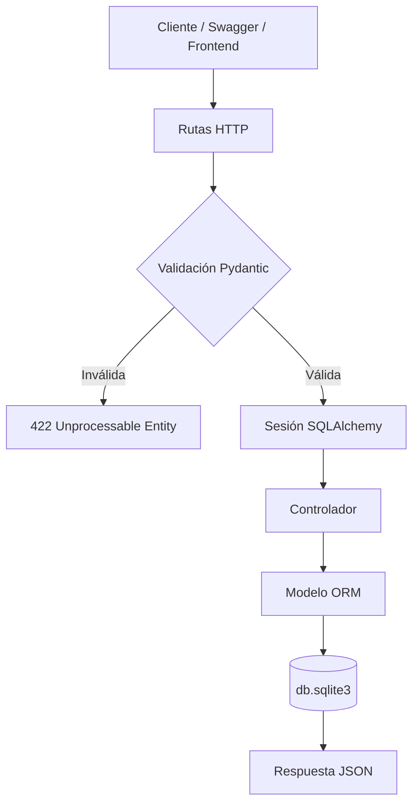
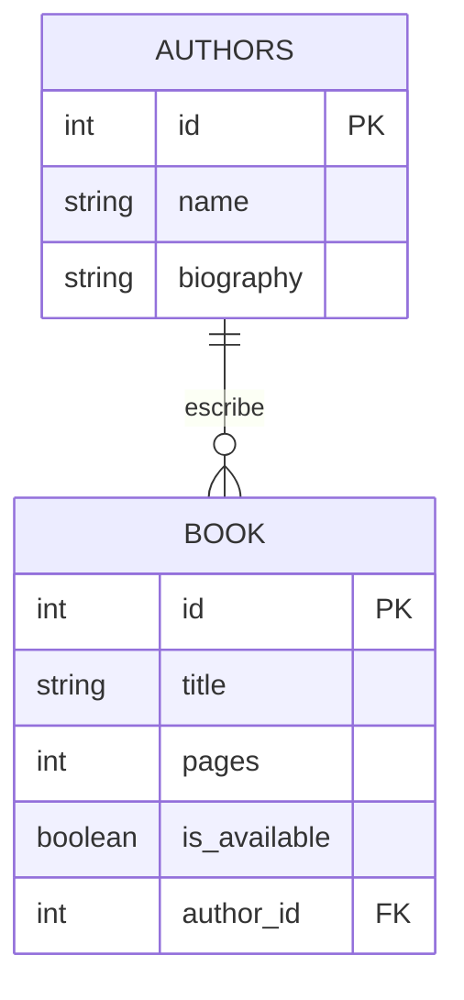

# API de Gestión de Libros con FastAPI y SQLite

Este repositorio contiene una API REST didáctica para gestionar libros y autores utilizando **FastAPI**, **SQLAlchemy**, **SQLite** y **Alembic**. El proyecto está organizado por capas para separar la configuración, la conexión a la base de datos, los modelos ORM, los esquemas Pydantic, los controladores y las rutas HTTP.

> **Nota:** El código fuente está escrito en inglés y esta guía está redactada en español para explicar el proyecto paso a paso. La API está preparada para ser consumida por Swagger, Postman o un frontend independiente.

## Índice

1. [Arquitectura y estructura](#arquitectura-y-estructura)
2. [Requisitos previos](#requisitos-previos)
3. [Instalación paso a paso](#instalación-paso-a-paso)
4. [Migraciones con Alembic](#migraciones-con-alembic)
5. [Tablas y relación entre modelos](#tablas-y-relación-entre-modelos)
6. [Arrancar el servidor](#arrancar-el-servidor)
7. [Pruebas con Swagger UI](#pruebas-con-swagger-ui)
8. [Endpoints y ejemplos](#endpoints-y-ejemplos)
9. [Estado actual](#estado-actual)
10. [Resolución de problemas](#resolución-de-problemas)

## Arquitectura y estructura

La estructura actual del proyecto es la siguiente:

```text
fastapi-api/
|
├── main.py                         # Punto de entrada de FastAPI
├── alembic.ini                     # Configuración de Alembic
├── alembic/
│   ├── env.py                      # Conexión de Alembic con SQLAlchemy
│   ├── README
│   ├── script.py.mako              # Plantilla de migraciones
│   └── versions/                   # Historial de cambios de la base de datos
├── config/
│   ├── __init__.py
│   └── config_variables.py         # Variables de entorno
├── database/
│   ├── __init__.py
│   └── database.py                 # Motor, Base y sesiones SQLAlchemy
├── model/
│   ├── __init__.py
│   ├── author_model.py             # Modelo ORM de authors
│   └── book_model.py               # Modelo ORM de book
├── schema/
│   ├── __init__.py
│   ├── author_schema.py             # Esquemas Pydantic de autores
│   └── book_schema.py              # Esquemas Pydantic de libros
├── controller/
│   ├── __init__.py
│   ├── author_controller.py         # Operaciones de autores
│   └── book_controller.py           # Operaciones de libros
├── routes/
│   ├── __init__.py
│   ├── author_routes.py             # Rutas /author/
│   └── routes.py                    # Rutas /book/
├── .env                            # Configuración local
├── .env.example                    # Plantilla de configuración
├── db.sqlite3                      # Base de datos SQLite local
├── requirements.txt                # Dependencias
└── README.md                       # Esta documentación
```

### Flujo de una petición

1. El cliente envía una petición HTTP a una ruta de `routes/`.
2. FastAPI valida el cuerpo mediante los esquemas de `schema/`.
3. `Depends(get_db)` proporciona una sesión SQLAlchemy.
4. La ruta delega la operación al controlador correspondiente.
5. El controlador consulta o modifica los modelos ORM de `model/`.
6. SQLAlchemy guarda o recupera los datos de SQLite.
7. Pydantic serializa el objeto ORM y FastAPI devuelve la respuesta JSON.



## Requisitos previos

Antes de comenzar necesitas:

- Python 3.10 o superior.
- `pip`.
- Un editor de código, como VS Code.

Puedes comprobar las versiones con:

```bash
python3 --version
pip --version
```

## Instalación paso a paso

### Paso 1: Situarse en el proyecto

```bash
cd /ruta/hacia/fastapi-api
```

### Paso 2: Crear el entorno virtual

En macOS y Linux:

```bash
python3 -m venv venv
```

En Windows:

```powershell
python -m venv venv
```

### Paso 3: Activar el entorno virtual

macOS o Linux:

```bash
source venv/bin/activate
```

Windows PowerShell:

```powershell
.\venv\Scripts\Activate.ps1
```

Windows CMD:

```cmd
.\venv\Scripts\activate.bat
```

### Paso 4: Instalar las dependencias

Con el entorno virtual activado:

```bash
pip install -r requirements.txt
```

Las dependencias principales son:

- `fastapi`: framework para construir la API.
- `uvicorn`: servidor ASGI.
- `sqlalchemy`: ORM para trabajar con SQLite.
- `alembic`: migraciones de la base de datos.
- `pydantic`: validación y serialización de datos.
- `python-dotenv`: lectura del archivo `.env`.

### Paso 5: Configurar las variables de entorno

El archivo `.env` utiliza esta configuración:

```env
APP_TITLE="Library"
APP_VERSION="0.0.1"
APP_DESCRIPTION="app de una librería"
DATABASE_NAME="db.sqlite3"
DATABASE_URL="sqlite:///./db.sqlite3"
```

Si el archivo `.env` no existe, puedes copiar la plantilla:

```bash
cp .env.example .env
```

`config/config_variables.py` aplica valores por defecto cuando una variable no está definida.

## Migraciones con Alembic

### ¿Por qué usamos Alembic?

`Base.metadata.create_all()` solo crea una tabla cuando todavía no existe. No modifica una tabla existente si añadimos una columna, cambiamos una restricción o incorporamos una relación.

Por ejemplo, cuando el modelo `Book` pasó de tener un autor como texto a utilizar `author_id`, `create_all()` no podía actualizar la tabla antigua. Alembic permite describir ese cambio en una migración y aplicarlo sin borrar los datos.

Alembic registra la revisión aplicada en la tabla `alembic_version`.

### Configuración de Alembic en este proyecto

El archivo `alembic/env.py` realiza estas tareas:

1. Añade la raíz del proyecto a `sys.path`.
2. Carga `DATABASE_URL` desde `.env`.
3. Importa `model` para que `Base.metadata` conozca `Book` y `Author`.
4. Configura las migraciones en modo offline u online.
5. Ejecuta `context.run_migrations()`.

La URL actual es:

```env
DATABASE_URL="sqlite:///./db.sqlite3"
```

### Historial de migraciones

Las revisiones del proyecto forman esta evolución:

1. `6d27021d7129`: crea la tabla `book` con título, páginas y disponibilidad.
2. `0a83a52985a0`: crea `authors` y añade `author_id` a `book`.
3. `c2a4ca782d46`: continúa la evolución de autores y libros.
4. `a8ff7600e682`: corrige la relación entre ambas tablas.
5. `9ba96e651b3f`: revisión de corrección del modelo de libros.
6. `cf0f74d0ff4e`: revisión de corrección de los modelos.
7. `d4f2c8a9b1e0`: permite que `book.pages` sea `NULL`.

La revisión actual es `d4f2c8a9b1e0`.

La última migración utiliza `batch_alter_table`, porque SQLite tiene limitaciones para modificar columnas mediante `ALTER TABLE` convencional.

### Aplicar las migraciones

Desde la raíz del proyecto y con el entorno virtual activado:

```bash
alembic upgrade head
```

Para consultar el estado:

```bash
alembic current
alembic heads
alembic history --verbose
```

La salida esperada de `alembic current` termina en:

```text
d4f2c8a9b1e0 (head)
```

### Crear una nueva migración

Cuando se modifica un modelo SQLAlchemy:

```bash
alembic revision --autogenerate -m "describe el cambio"
```

Antes de aplicarla, revisa siempre el archivo creado en `alembic/versions/`. Después ejecuta:

```bash
alembic upgrade head
```

Para deshacer la última revisión:

```bash
alembic downgrade -1
```

Para volver al estado inicial:

```bash
alembic downgrade base
```

## Tablas y relación entre modelos

Después de aplicar las migraciones, SQLite contiene dos tablas relacionadas:

- `authors`: almacena los autores.
- `book`: almacena los libros.

La relación es **uno a muchos (1:N)**:

- Un autor puede tener muchos libros.
- Un libro puede tener cero o un autor.
- `book.author_id` apunta a `authors.id`.
- La relación utiliza `ON DELETE SET NULL`: si se elimina el autor, el libro se conserva y su `author_id` queda vacío.



### Paso 1: Crear la tabla `book`

La primera migración crea la tabla de libros:

```python
op.create_table(
    "book",
    sa.Column("id", sa.Integer(), autoincrement=True, nullable=False),
    sa.Column("title", sa.String(length=150), nullable=False),
    sa.Column("pages", sa.Integer(), nullable=False),
    sa.Column("is_available", sa.Boolean(), nullable=False, default=True),
    sa.PrimaryKeyConstraint("id")
)
```

Más adelante, la migración `d4f2c8a9b1e0` cambia `pages` para que sea opcional. El estado final es equivalente a:

```python
pages = Column(Integer, nullable=True)
```

La columna sigue validando en Pydantic que, cuando se envía un número, sea mayor que cero.

### Paso 2: Crear la tabla `authors`

La tabla de autores tiene estos campos:

| Campo | Tipo | Obligatorio | Descripción |
| --- | --- | --- | --- |
| `id` | `Integer` | Sí | Clave primaria autoincremental |
| `name` | `String(100)` | Sí | Nombre del autor |
| `biography` | `String(500)` | No | Biografía del autor |

Su modelo ORM es:

```python
class Author(Base):
    __tablename__ = "authors"

    id = Column(Integer, primary_key=True, index=True, autoincrement=True)
    name = Column(String(100), nullable=False, index=True)
    biography = Column(String(500), nullable=True)

    books = relationship(
        "Book",
        back_populates="author",
        cascade="all, delete-orphan"
    )
```

### Paso 3: Añadir la relación a `Book`

El modelo de libros contiene la clave foránea y la relación ORM:

```python
class Book(Base):
    __tablename__ = "book"

    id = Column(Integer, primary_key=True, index=True, autoincrement=True)
    title = Column(String(150), nullable=False, index=True)
    pages = Column(Integer, nullable=True)
    is_available = Column(Boolean, default=True, nullable=False)

    author_id = Column(
        Integer,
        ForeignKey("authors.id", ondelete="SET NULL"),
        nullable=True
    )

    author = relationship("Author", back_populates="books")
```

`ForeignKey` crea la relación física en SQLite. `relationship()` permite navegar desde Python mediante `book.author` y `author.books`.

### Paso 4: Definir los esquemas Pydantic

Los esquemas separan el JSON de la estructura interna de SQLAlchemy:

```python
class BookBase(BaseModel):
    title: str = Field(..., min_length=1, max_length=150)
    author_id: Optional[int] = None
    pages: Optional[int] = Field(None, gt=0)
    is_available: bool = Field(default=True)
```

En un libro:

- `title` es obligatorio.
- `author_id` es opcional.
- `pages` es opcional; si se envía, debe ser mayor que cero.
- `is_available` es opcional y por defecto vale `true`.

La respuesta incluye el autor anidado cuando existe:

```python
class BookResponse(BookBase):
    id: int
    author: Optional[AuthorResponse] = None

    model_config = ConfigDict(from_attributes=True)
```

Para los autores:

```python
class AuthorBase(BaseModel):
    name: str = Field(..., min_length=1, max_length=100)
    biography: Optional[str] = Field(None, max_length=500)
```

### Paso 5: Controladores y rutas

Los controladores contienen las operaciones de persistencia. Por ejemplo, crear un libro consiste en construir el objeto, añadirlo a la sesión, confirmar la transacción y refrescarlo:

```python
new_book = Book(
    title=book_data.title,
    author_id=book_data.author_id,
    pages=book_data.pages,
    is_available=book_data.is_available
)

db.add(new_book)
db.commit()
db.refresh(new_book)
```

Si ocurre un error SQLAlchemy, el controlador hace `rollback()` y devuelve un error HTTP 500.

Las rutas disponibles usan estos prefijos:

```python
book_router = APIRouter(prefix="/book", tags=["Book"])
author_router = APIRouter(prefix="/author", tags=["Author"])
```

## Arrancar el servidor

Con el entorno virtual activado, aplica primero las migraciones y después arranca FastAPI:

```bash
alembic upgrade head
uvicorn main:app --reload
```

También puedes utilizar el ejecutable del entorno virtual directamente:

```bash
venv/bin/uvicorn main:app --reload
```

Direcciones disponibles:

- API: <http://127.0.0.1:8000>
- Swagger UI: <http://127.0.0.1:8000/docs>
- ReDoc: <http://127.0.0.1:8000/redoc>

`Base.metadata.create_all()` se conserva como apoyo para crear tablas ausentes, pero no reemplaza a Alembic y no modifica columnas existentes.

## Pruebas con Swagger UI

1. Ejecuta `uvicorn main:app --reload`.
2. Abre <http://127.0.0.1:8000/docs>.
3. Selecciona un endpoint.
4. Pulsa **Try it out**.
5. Introduce los datos JSON.
6. Pulsa **Execute**.

## Endpoints y ejemplos

| Método | Ruta | Descripción | Respuesta |
| --- | --- | --- | --- |
| `GET` | `/` | Comprueba que la API está activa | `200 OK` |
| `GET` | `/book/` | Lista libros con paginación | `200 OK` |
| `POST` | `/book/` | Crea un libro | `201 Created` |
| `GET` | `/author/` | Lista autores con paginación | `200 OK` |
| `POST` | `/author/` | Crea un autor | `201 Created` |

Actualmente no existen rutas para obtener un libro por ID, actualizarlo o eliminarlo.

### Comprobar el estado de la API

```bash
curl http://127.0.0.1:8000/
```

Respuesta:

```json
{
  "status": "online",
  "message": "Welcome to Library",
  "docs_url": "/docs",
  "redoc_url": "/redoc"
}
```

### Crear un autor

```bash
curl -X POST "http://127.0.0.1:8000/author/" \
  -H "Content-Type: application/json" \
  -d '{
    "name": "Miguel de Cervantes",
    "biography": "Autor de Don Quijote"
  }'
```

Respuesta esperada:

```json
{
  "name": "Miguel de Cervantes",
  "biography": "Autor de Don Quijote",
  "id": 1
}
```

### Crear un libro con autor

```bash
curl -X POST "http://127.0.0.1:8000/book/" \
  -H "Content-Type: application/json" \
  -d '{
    "title": "Don Quijote",
    "author_id": 1,
    "pages": 850,
    "is_available": true
  }'
```

`author_id` y `pages` son opcionales. Por ejemplo, también es válido:

```json
{
  "title": "Libro sin paginar"
}
```

Cuando el autor existe, la respuesta incluye la relación:

```json
{
  "title": "Don Quijote",
  "author_id": 1,
  "pages": 850,
  "is_available": true,
  "id": 1,
  "author": {
    "name": "Miguel de Cervantes",
    "biography": "Autor de Don Quijote",
    "id": 1
  }
}
```

### Listar libros

```bash
curl "http://127.0.0.1:8000/book/?skip=0&limit=10"
```

`skip` comienza en `0` y `limit` acepta valores entre `1` y `100`.

### Listar autores

```bash
curl "http://127.0.0.1:8000/author/?skip=0&limit=10"
```

### Validación de datos

Esta petición devuelve `422 Unprocessable Entity`, porque `pages` no puede ser negativo:

```bash
curl -X POST "http://127.0.0.1:8000/book/" \
  -H "Content-Type: application/json" \
  -d '{
    "title": "Libro inválido",
    "pages": -1
  }'
```

## Estado actual

La versión actual permite:

- Cargar configuración desde `.env`.
- Mantener el esquema de SQLite con Alembic.
- Crear y consultar libros.
- Crear y consultar autores.
- Relacionar libros con autores mediante `author_id`.
- Dejar `author_id`, `pages` y `biography` como campos opcionales.
- Validar los datos con Pydantic.
- Serializar el autor dentro de la respuesta del libro.
- Consultar la API desde Swagger UI y ReDoc.

### Próximos pasos posibles

- Añadir `GET /book/{book_id}`.
- Completar `BookUpdate` y crear rutas `PUT` o `PATCH`.
- Añadir `DELETE` para libros y autores.
- Corregir y conectar el esquema `BookUpdate` con las rutas.
- Añadir tests automatizados.
- Restringir `allow_origins` a los dominios reales en producción.

## Resolución de problemas

### `ModuleNotFoundError: No module named 'fastapi'`

Activa el entorno virtual e instala las dependencias:

```bash
source venv/bin/activate
pip install -r requirements.txt
```

### El comando `alembic` no se encuentra

Comprueba que el entorno virtual está activado. También puedes utilizar:

```bash
venv/bin/alembic upgrade head
```

### `table book has no column named author_id`

La base de datos no tiene aplicadas las migraciones actuales. Desde la raíz del proyecto ejecuta:

```bash
alembic upgrade head
```

No basta con ejecutar `create_all()`, porque no modifica tablas que ya existen.

### `NOT NULL constraint failed: book.pages`

La base de datos utiliza una revisión antigua en la que `pages` era obligatorio. Actualiza el esquema:

```bash
alembic upgrade head
```

La revisión `d4f2c8a9b1e0` permite guardar libros sin número de páginas.

### La API no muestra los libros

Comprueba que utilizas el prefijo singular `/book/` y que estás consultando la misma base configurada en `.env`:

```env
DATABASE_URL="sqlite:///./db.sqlite3"
```

### Reiniciar la base de datos

Detén el servidor y elimina la base local:

```bash
rm db.sqlite3
alembic upgrade head
uvicorn main:app --reload
```

En Windows puedes eliminar `db.sqlite3` desde el explorador o utilizar:

```powershell
Remove-Item db.sqlite3
```

Este procedimiento elimina los datos locales y debe utilizarse solo cuando quieras reconstruir la base desde cero.